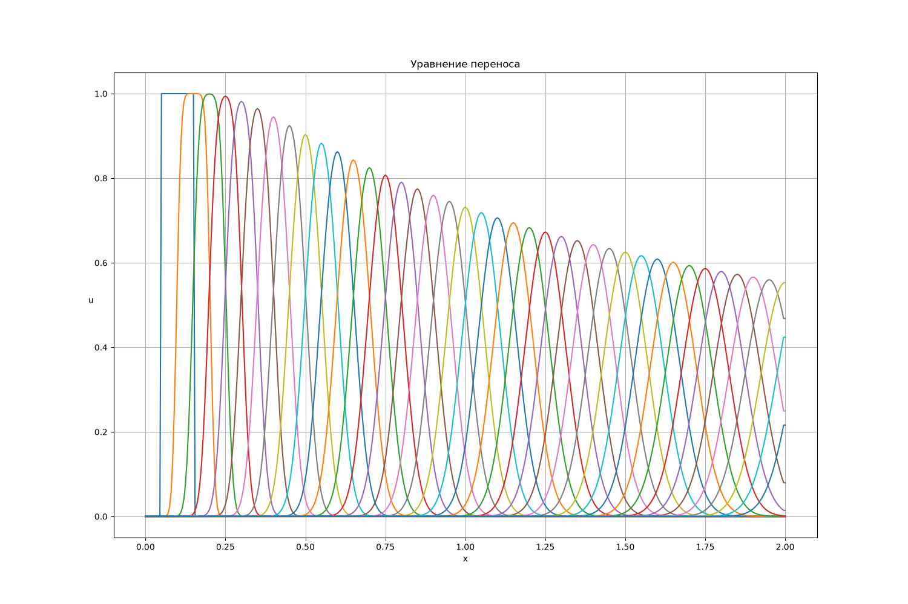
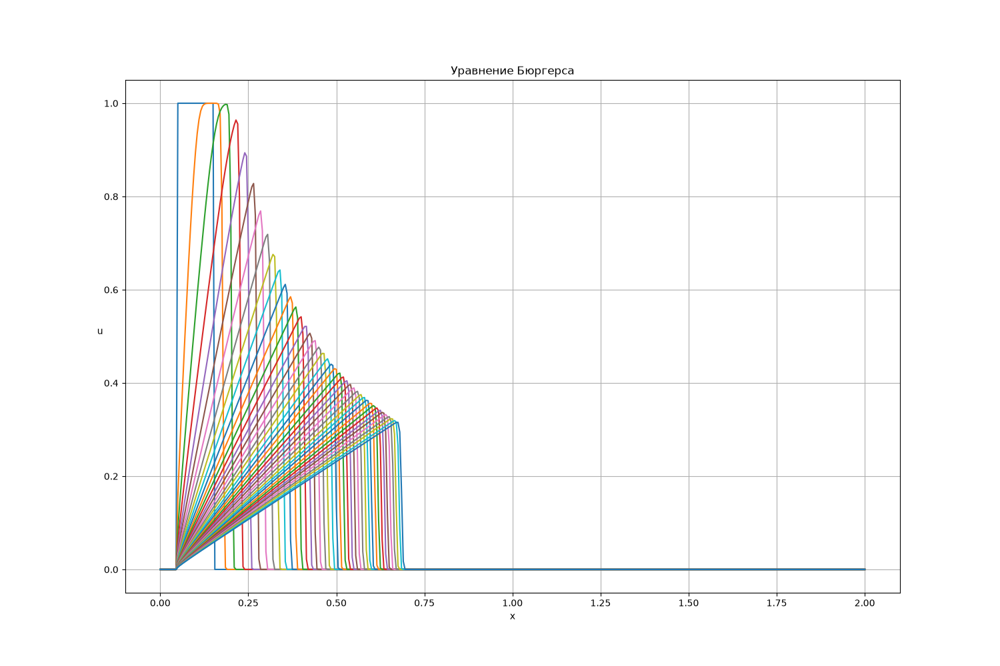

# Численное решение уравнения переноса и уравнения Бюргерса

Явная разностная схема 1-го порядка (upwind) для квазилинейного
уравнения в частных производных

$$\frac{\partial u}{\partial t}+\cdot\frac{\partial f(u)}{\partial x} = 0$$

где

- `f(u) = a·u` — уравнение переноса (линейное, `a = const`),
- `f(u) = u²/2` — уравнение Бюргерса (нелинейное, инвисцидное).

Схема реализована на языке C, визуализация — в Jupyter-ноутбуке
на Python (`pandas` + `matplotlib` + `seaborn`).

## Стек

- **C**, `gcc`, `make` — численная часть;
- **Python**, `pandas`, `matplotlib`, `seaborn` — визуализация.

## Сборка

```bash
make
```

Появится исполняемый файл `main`.

## Запуск

```bash
./main              # использует params.txt по умолчанию
./main my_params.txt  # или явно указать файл
```

На выходе — `result.csv` с колонками:

| Столбец   | Смысл                                      |
|-----------|--------------------------------------------|
| `t`       | время                                      |
| `X`       | координата узла                            |
| `U`       | численное решение                          |
| `U_exact` | точное решение (там, где оно известно)     |

 Для уравнения Бюргерса с _нелинейным_ начальным условием
 столбец `U_exact` равен `0`: аналитического решения в общем случае
 нет. Точное решение выводится только для линейного НУ
 `u0(x) = kx + b` и имеет вид `u(x,t) = (kx + b) / (1 + kt)`.

## Параметры (`params.txt`)

Все параметры задаются в текстовом файле `params.txt` в виде `ключ = значение`.
Комментарии после `#` игнорируются.

| Ключ             | Тип    | Значение                                                                 |
|------------------|--------|--------------------------------------------------------------------------|
| `equation_type`  | int    | `0` — перенос, `1` — Бюргерс                                             |
| `a`              | double | скорость переноса (используется только при `equation_type = 0`)          |
| `x_min`, `x_max` | double | границы расчётной области (`x_min < x_max`)                              |
| `t_max`          | double | время окончания расчёта (`> 0`)                                          |
| `t_exp`          | double | период вывода в CSV (`0 < t_exp ≤ t_max`)                                |
| `boundary_type`  | int    | `0` — «неотражающее» `d/dx = 0`, `1` — периодическое                     |
| `u0_type`        | int    | `0` — ступенька, `1` — треугольник, `2` — гаусс, `3` — линейная `y = kx+b` |
| `u0_par1`        | double | центр / матожидание / `k`                                                |
| `u0_par2`        | double | высота / дисперсия / `b`                                                 |
| `u0_par3`        | double | ширина (только для ступеньки и треугольника)                             |
| `N`              | int    | число отрезков разбиения области (`≥ 2`)                                 |
| `Co`             | double | число Куранта, `0 < Co ≤ 1`                                              |

Шаг по времени выбирается автоматически по условию Куранта–Фридрихса–Леви:

$$\Delta t= Co \cdot \frac{\Delta x}{s_{max}}$$

где `s_max = |a|` для переноса и `s_max = max|u|` для Бюргерса
(пересчитывается на каждом шаге).

### Пример `params.txt`

```ini
equation_type = 0        # уравнение переноса
a             = 1.0
x_min         = 0.0
x_max         = 1.0
t_max         = 1.0
t_exp         = 0.05
boundary_type = 1        # периодическое
u0_type       = 0        # ступенька
u0_par1       = 0.5      # центр
u0_par2       = 1.0      # высота
u0_par3       = 0.1      # ширина
N             = 400
Co            = 0.5
```

## Визуализация

```bash
jupyter result.ipynb
```

Ноутбук читает `result.csv` и строит:

- семейство профилей `u(x)` в разные моменты времени;
- отдельный срез при фиксированном `t` с наложением точного решения.

Пример полученных изображений у уравнения переноса и уравнения Бюргерса:



## Ограничения

- Схема **1-го порядка** — на разрывах и ударных волнах профиль
  «размывается» на несколько ячеек. Это ожидаемое поведение, а не баг.
- Для Бюргерса при `u0_type = 3` (`kx + b`) и `k < 0` решение
  существует только до момента `t = -1/k` (градиентная катастрофа).
  При `t_max ≥ -1/k` в решении появятся `NaN`/`inf`.
- При периодических граничных условиях `u[0]` и `u[N]` — служебные
  узлы, они не обязаны совпадать физически, хотя и «склеены» через
  схему.

## Структура проекта

```
.
├── README.md
├── Makefile
├── params.h            # структура Params, прототипы
├── params.c            # чтение/валидация/печать параметров, write_state
├── for_solution.c      # начальное условие и точное решение
├── main.c              # основной цикл по времени
├── params.txt          # файл параметров
├── visualize.ipynb
└── img/                # сюда сохраняются графики
```
